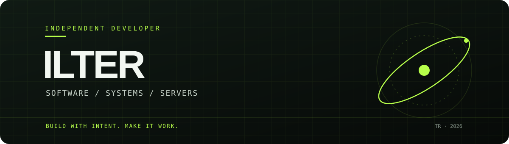

 

**I turn ideas into working software.**

I build across web, desktop, mobile and server environments — with a focus on practical tools, clean workflows and understanding how systems fit together.

  

---

## 01 / WHAT I WORK ON

- **Software & tools** — utilities, automation and developer-focused applications.
- **Web & mobile** — interfaces, full-stack projects and product ideas.
- **Systems & infrastructure** — Windows and Linux environments, VDS hosting and server administration.
- **Minecraft infrastructure** — PaperMC servers, Velocity networks and multi-server setups.

## 02 / SELECTED PROJECTS

### [ADB-QR](https://github.com/ilter2014/ADB-QR)
A Windows utility for Android Debug Bridge wireless pairing and device workflows.

  

### [CmdTools](https://github.com/ilter2014/CmdTools)
A collection of command-line tools and practical Windows utilities.

  

### [headphone-animation](https://github.com/ilter2014/headphone-animation)
A forked animation experiment.

  

### [instagram-flutter-clone](https://github.com/ilter2014/instagram-flutter-clone)
A Flutter UI clone inspired by Instagram. This is a forked repository.

  

---

## 03 / TECH STACK

### Languages & Data

### Frameworks & App Development

### Operating Systems & Hosting

### Backend, Databases & Deployment

### Developer Tools

### Video, Motion & Audio

### Minecraft Server Engineering

---

## 04 / GITHUB ACTIVITY

 

---

**BUILD WITH INTENT · MAKE IT WORK · KEEP IMPROVING**

Thanks for stopping by.

