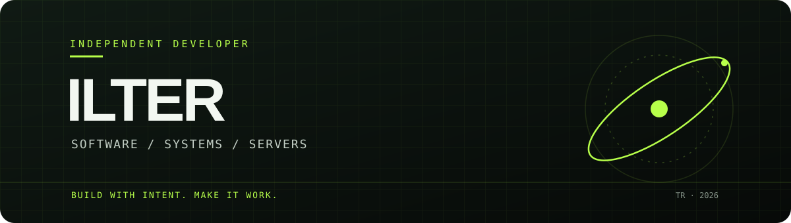

 

**Fikirleri çalışan yazılımlara dönüştürüyorum.**

Web, masaüstü, mobil ve sunucu ortamlarında projeler geliştiriyorum. Odağım; işe yarayan araçlar üretmek, sağlam iş akışları kurmak ve sistemlerin nasıl çalıştığını gerçekten anlamak.

  

---

## 01 / NELER GELİŞTİRİYORUM

- **Yazılım ve araçlar** — yardımcı programlar, otomasyon ve geliştirici araçları.
- **Web ve mobil** — arayüzler, uçtan uca projeler ve ürün fikirleri.
- **Sistem ve altyapı** — Windows/Linux ortamları, VDS barındırma ve sunucu yönetimi.
- **Minecraft altyapısı** — PaperMC sunucuları, Velocity ağları ve çoklu sunucu sistemleri.

## 02 / ÖNE ÇIKAN PROJELER

### [ADB-QR](https://github.com/ilter2014/ADB-QR)
Android Debug Bridge kablosuz eşleştirme ve cihaz işlemleri için geliştirilmiş Windows aracı.

  

### [CmdTools](https://github.com/ilter2014/CmdTools)
Komut satırı araçları ve kullanışlı Windows yardımcı programları koleksiyonu.

  

### [headphone-animation](https://github.com/ilter2014/headphone-animation)
Fork edilmiş bir animasyon denemesi.

  

### [instagram-flutter-clone](https://github.com/ilter2014/instagram-flutter-clone)
Instagram arayüzünden esinlenen Flutter klon projesi. Fork edilmiş bir depodur.

  

---

## 03 / TEKNOLOJİLER

### Programlama ve Veri

### Framework ve Uygulama Geliştirme

### İşletim Sistemleri ve Hosting

### Backend, Veritabanı ve Dağıtım

### Geliştirme Araçları

### Video, Hareket ve Ses

### Minecraft Sunucu Mühendisliği

---

## 04 / GITHUB HAREKETLERİ

 

---

**NİYETLE GELİŞTİR · ÇALIŞIR HALE GETİR · DAHA İYİSİNİ YAP**

Profilime uğradığın için teşekkürler.

